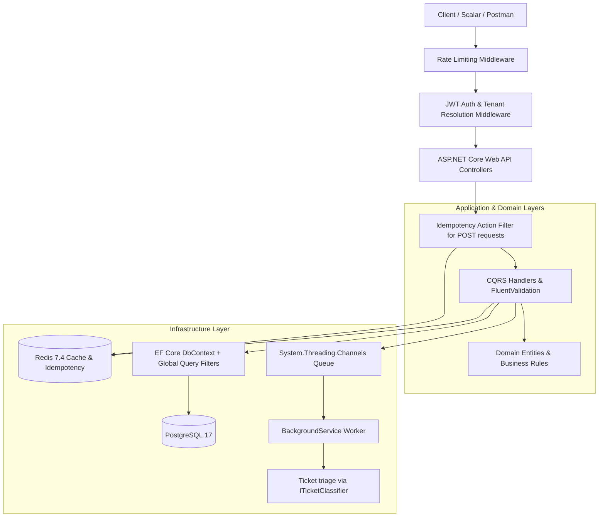

# NexusCRM — Multi-Tenant B2B Sales & Support API

[](https://dotnet.microsoft.com)
[](https://www.postgresql.org)
[](https://redis.io)
[](https://www.docker.com)

A **Multi-Tenant B2B Sales & Support CRM Backend** built with **Modern .NET, Clean Architecture, EF Core, PostgreSQL, and Redis**.

Designed to demonstrate real-world SaaS engineering patterns: row-level tenant isolation, optimistic concurrency control, idempotent mutations, non-blocking background workers, and automated integration testing with Testcontainers.

> **Status:** in active development. See the [roadmap](#-implementation-roadmap-build-checklist) for what is done. The full requirements live in [`docs/NexusCRM-PRD.pdf`](docs/NexusCRM-PRD.pdf).

---

## 🎯 Business & Engineering Problem

Growing B2B teams lose revenue and delay customer resolutions when customer profiles, deal pipelines, and support tickets are scattered across disconnected tools. However, building a shared SaaS backend introduces critical engineering challenges:

1. **Cross-Tenant Data Leaks:** Ensuring Company A can never read or modify Company B's data, even if a developer forgets a `WHERE` clause.
2. **Race Conditions & Silent Overwrites:** Preventing two sales reps from overwriting each other's deal updates simultaneously.
3. **Slow API Latency on Heavy Tasks:** Keeping HTTP response times low when ticket creation triggers email notifications or AI priority classification.
4. **Duplicate Mutations on Network Retries:** Ensuring flaky connections retrying a `POST` request do not create duplicate deals or tickets.
5. **Database Bottlenecks on Analytics:** Serving real-time pipeline dashboards without hammering PostgreSQL on every page load.

---

## 🏗️ System Architecture

NexusCRM follows **Clean Architecture** with strict dependency rules (`Api` → `Application` → `Domain`, with `Infrastructure` implementing `Application` interfaces).



### Key Architectural Decisions & Trade-Offs

| Engineering Concern | Implementation | Why This Choice? |
| :--- | :--- | :--- |
| **Multi-Tenancy** | Single database, shared schema with `TenantId` + **EF Core Global Query Filters** & `SaveChangesAsync` interceptor | Eliminates manual `.Where(x => x.TenantId == id)` bugs while avoiding the operational cost of separate databases per tenant. |
| **Concurrency Control** | PostgreSQL `xmin` system column mapped as EF Core concurrency token | Detects concurrent edits without extra schema columns and returns standardized `409 Conflict` `ProblemDetails`. |
| **Idempotency** | Custom action filter backed by Redis (`24h` TTL) via `Idempotency-Key` header | Safely handles client retries on `POST` endpoints without creating duplicate deals or tickets. |
| **Async Processing** | Bounded `System.Threading.Channels` + `BackgroundService` | Decouples AI ticket triage and notifications from the HTTP request lifecycle with zero external broker overhead. |
| **Caching Strategy** | Cache-aside with Redis + explicit invalidation | Speeds up pipeline dashboard metrics and refreshes them whenever a `Deal` changes. |
| **Error Handling** | Global `IExceptionHandler` returning RFC 9457 `ProblemDetails` | Never leaks stack traces; maps domain, validation and concurrency exceptions to predictable HTTP status codes. |

---

## 📂 Solution Structure

```text
NexusCRM/
├── src/
│   ├── NexusCRM.Domain/              # Entities, value objects, domain exceptions (zero dependencies)
│   ├── NexusCRM.Application/         # Use cases, DTOs, interfaces, FluentValidation
│   ├── NexusCRM.Infrastructure/      # EF Core, interceptors, Redis, channels, JWT, ticket classifier
│   └── NexusCRM.Api/                 # Controllers, middleware, filters, exception handler, Program.cs
├── tests/
│   ├── NexusCRM.UnitTests/           # Domain rules and validation tests (xUnit)
│   └── NexusCRM.IntegrationTests/    # API tests with WebApplicationFactory + Testcontainers
├── docs/                             # Product requirements document
├── docker-compose.yml                # PostgreSQL, Redis, and API containers
├── Dockerfile
└── README.md
```

---

## 🗄️ Core Domain Model

* **Tenant:** A registered organization (`Id`, `Name`, `Slug`, `SubscriptionPlan`, `IsActive`).
* **User:** Belongs to a `Tenant` with role-based access control (`Admin`, `SalesRep`, `SupportAgent`).
* **Customer:** Client accounts managed by a tenant (`Id`, `TenantId`, `CompanyName`, `ContactEmail`, `Status`).
* **Deal:** Sales pipeline progression (`Lead` → `Qualified` → `Proposal` → `Negotiation` → `Won` / `Lost`), `Amount`, `Currency`, `AssignedUserId`, and the optimistic concurrency token (`xmin`).
* **Ticket:** Customer support requests (`Open` → `InProgress` → `Resolved` → `Closed`), `Priority` (`Low`, `Medium`, `High`, `Critical`), `AiSummary`, and async triage status.
* **Audit fields:** Populated automatically by an EF Core `SaveChangesInterceptor` (`CreatedBy`, `CreatedAt`, `UpdatedBy`, `UpdatedAt`).

---

## 🚀 Getting Started

### Prerequisites
* [.NET 10 SDK](https://dotnet.microsoft.com/download)
* [Docker Desktop](https://www.docker.com/products/docker-desktop/)

### Run with Docker Compose (Recommended)

```bash
# 1. Clone the repository
git clone https://github.com/<your-username>/NexusCRM.git
cd NexusCRM

# 2. Start PostgreSQL, Redis, and the Web API
docker compose up --build -d

# 3. Open the interactive API documentation (Scalar)
# Navigate to: http://localhost:8080/scalar/v1
```

### Run Locally for Development

```bash
# Start only the infrastructure dependencies
docker compose up -d postgres redis

# Apply EF Core migrations (available from Phase 2)
dotnet ef database update --project src/NexusCRM.Infrastructure --startup-project src/NexusCRM.Api

# Run the API
dotnet run --project src/NexusCRM.Api
```

---

## 🔌 Core API Endpoints

| Method | Endpoint | Auth / Role | Key Feature Demonstrated |
| :--- | :--- | :--- | :--- |
| `POST` | `/api/v1/auth/register-tenant` | Public | Creates Tenant + Admin user, returns JWT |
| `POST` | `/api/v1/auth/login` | Public | Issues JWT with `tenant_id` and `role` claims |
| `POST` | `/api/v1/customers` | `Admin`, `SalesRep` | Auto-stamps `TenantId` via EF Core interceptor |
| `GET` | `/api/v1/customers` | Authenticated | Offset pagination, search, automatic tenant isolation |
| `POST` | `/api/v1/deals` | `Admin`, `SalesRep` | Requires `Idempotency-Key` header to prevent duplicate deals |
| `PATCH` | `/api/v1/deals/{id}/stage` | `Admin`, `SalesRep` | State machine rules + `xmin` optimistic concurrency + cache invalidation |
| `POST` | `/api/v1/tickets` | Authenticated | Saves ticket and queues background triage via `Channel<T>` |
| `GET` | `/api/v1/analytics/pipeline` | `Admin`, `SalesRep` | Served from Redis cache-aside (`5m` TTL + invalidation on deal changes) |

---

## 🧪 Running Automated Tests

Integration tests start **ephemeral PostgreSQL and Redis Docker containers** automatically via **Testcontainers**, with no mocked databases.

```bash
# Run all unit and integration tests
dotnet test
```

### What Is Tested?
* **Tenant Isolation Test:** A user from `Tenant 1` receives `404 Not Found` when accessing resources owned by `Tenant 2`.
* **Optimistic Concurrency Test:** Two updates to the same `Deal` using the same row version; the second fails with `409 Conflict`.
* **Idempotency Test:** Identical `POST /api/v1/deals` requests with the same `Idempotency-Key` create only one database record.
* **Background Triage Test:** Creating a `Ticket` results in the `BackgroundService` asynchronously updating its priority and summary.

---

## 🛠️ Implementation Roadmap (Build Checklist)

- [x] **Phase 1 — Foundation:** Clean Architecture projects, `docker-compose.yml` (Postgres + Redis), global `IExceptionHandler` (`ProblemDetails`), Scalar setup.
- [ ] **Phase 2 — Multi-Tenancy & Auth:** `ITenantProvider`, ASP.NET Core Identity, JWT, EF Core global query filters, and the audit `SaveChangesInterceptor`.
- [ ] **Phase 3 — Sales Pipeline (`Customer` & `Deal`):** FluentValidation, state-transition domain logic, PostgreSQL `xmin` concurrency handling (`409 Conflict`).
- [ ] **Phase 4 — Idempotency & Redis Caching:** Custom idempotency action filter + Redis cache-aside for `/api/v1/analytics/pipeline`.
- [ ] **Phase 5 — Async Helpdesk (`Ticket`):** `System.Threading.Channels` producer/consumer + `BackgroundService` (with a pluggable rule-based or AI ticket classifier).
- [ ] **Phase 6 — Testing & CI:** xUnit unit tests, `WebApplicationFactory` + Testcontainers integration tests, and a GitHub Actions workflow.

---

## 🤝 Development Workflow

* **GitHub Flow:** `main` is protected; every change goes through a short-lived branch (`feature/…`, `fix/…`, `docs/…`) and a pull request, merged with **squash and merge**.
* **Commits** follow [Conventional Commits](https://www.conventionalcommits.org) (`feat:`, `fix:`, `chore:`, `docs:`, `test:`).
